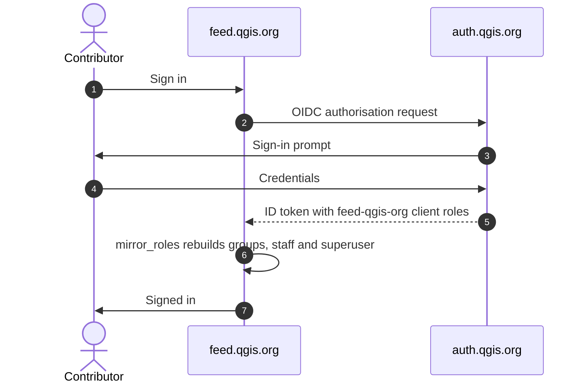

# Single sign-on with auth.qgis.org

This page is for the people who run the feed site. It explains how people sign
in through the QGIS account service, and which settings control it.

Contributors have their own guide at `/sso/help/`. It explains how to get an
account, what each role allows, and what to do when you cannot sign in. Anybody
can read it while signed out. It lives in
`qgisfeedproject/templates/qgis_sso/help.html`, so update it with the code.

The [design notes](sso-design.md) explain why the rules below exist.

## How a sign-in works

Keycloak owns the account and the credential. This site keeps a link to the
Keycloak subject and a copy of what the roles mean here.

We rebuild the Django groups and the staff and superuser flags from the
Keycloak client roles at every sign-in. When you add or remove a role in
Keycloak, the change applies here at the person's next sign-in.

> **Edit roles in Keycloak, on the `feed-qgis-org` client.** If you change the
> checkboxes in `/admin/` on a linked account, the next sign-in undoes it.

## What each role grants

`SSO_ROLE_MAP` in `settings.py` holds the mapping. Mirroring only touches the
groups in `SSO_MANAGED_GROUPS`, so any other group survives a sign-in.

| Keycloak client role | Django groups | staff | superuser |
|---|---|---|---|
| `admin` | authors, approver | ✅ | ✅ |
| `web-maintainer` | authors, approver | ✅ | ✅ |
| `reviewer` | authors, approver | ✅ | |
| `usergroup-author` | authors | ✅ | |
| `author` | authors | ✅ | |

## Retiring local login

The user list in the admin has an **SSO account** filter. Combine it with the
*last login* filter to find active accounts that are not linked yet. Every
sign-in with a local password is recorded, so you can count them under **SSO
audit events**, filtered by action.

> ⚠ **Keep `LOCAL_LOGIN_ENABLED` on until break-glass access exists and has
> been tested.** Without it, a Keycloak outage locks out every administrator.

## Settings reference

| Setting | Meaning |
|---|---|
| `LOCAL_LOGIN_ENABLED` | Turns on the password backend, the password form, and password sign-in at `/admin/login/`. |
| `SSO_MIGRATION_LINKING` | Links a token to an existing local account when the username and a verified email both match. Turn it on only during the cutover. |
| `OIDC_CREATE_USER` | Must stay `False`. The realm federates the OSGeo LDAP directory. |
| `OIDC_RP_CLIENT_SECRET` | The client secret. Set it in `settings_local`, never in the process environment. |
| `SSO_RETIRE_PASSWORD_ON_LOGIN` | Retires the local password at the first SSO sign-in. `False` keeps both ways in open. |
| `QGIS_AUTH_URL` | The public address of the account service. The OIDC endpoints and the expected token issuer come from it. |
| `SSO_KEYCLOAK_REALM` | The realm name, `qgis` by default. |
