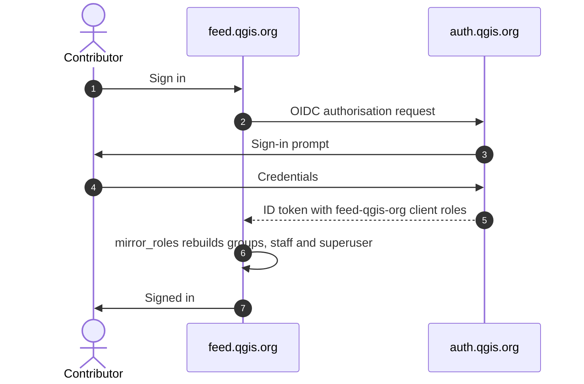

# Single sign-on with auth.qgis.org

This page is for the people who run the feed site. It explains how people sign
in through the QGIS account service, and which settings control it.

Contributors have their own guide at `/sso/help/`. It explains how to get an
account, set up a passkey, what each role allows, and what to do when you
cannot sign in. Anybody can read it while signed out. It lives in
`qgisfeedproject/templates/qgis_sso/help.html`, so update it with the code.

The [design notes](sso-design.md) explain why the rules below exist.

## How a sign-in works

Keycloak owns the account and the credential. This site keeps a link to the
Keycloak subject and a copy of what the roles mean here.

We rebuild the Django groups and the staff and superuser flags from the
Keycloak client roles at every sign-in. When you add or remove a role in
Keycloak, the change applies here at the person's next sign-in.

> **Edit roles in Keycloak, on the `feed-qgis-org` client.** If you change the
> checkboxes in `/admin/` on a linked account, the next sign-in undoes it.

## What each role grants

`SSO_ROLE_MAP` in `settings.py` holds the mapping. Mirroring only touches the
groups in `SSO_MANAGED_GROUPS`, so any other group survives a sign-in.

| Keycloak client role | Django groups | staff | superuser |
|---|---|---|---|
| `admin` | authors, approver | ✅ | ✅ |
| `web-maintainer` | authors, approver | ✅ | ✅ |
| `reviewer` | authors, approver | ✅ | |
| `usergroup-author` | authors | ✅ | |
| `author` | authors | ✅ | |

## Linking to an account that already exists in the realm

The realm is shared with hub and plugins, so a long-standing contributor here
very likely has a QGIS account already. For those accounts *Create the Keycloak
account* links to the QGIS account it matched. The confirmation page lists them
as **Will be linked to**, followed by the realm username. We create nothing in
the realm, and linking grants no privilege the account did not already hold
here.

We match on one thing only: an exact address that Keycloak reports as verified.
Three cases are refused, and the page names which one it hit. The address
differs, the realm has not verified it, or the realm account already belongs to
somebody here. One run links up to `SSO_ADMIN_ACTION_MAX_USERS` accounts (25).

## Migrating a wave in the admin

To move a wave of people, use the Django admin: filter the changelist, select
the accounts, then run an action. All four actions are superuser only and
audited, and each one does a single thing, so no step happens as a side effect
of another.

| Where | Action | What it does |
|---|---|---|
| Users | Export the migration report | Downloads a CSV and changes nothing. |
| Users | Create the Keycloak account | Creates realm accounts and sends no email. |
| Keycloak identities | Send the account-setup email | Invites them, and you can run it again. |
| Keycloak identities | Disable the local Django password | Retires the password fallback, near the end of a migration. |

**1. Read the report first.** The CSV tells you the Keycloak username and the
client roles each account would get. It also flags the accounts that need a
person to decide: a missing email address, a deactivated account, and accounts
that are dormant or have never been used. Keep the file as your record of the
migration.

**2. Create the accounts.** A confirmation page lists the outcome for each
person before we write anything, and that page is the only preview you get. We
hold the flagged accounts back unless you tick the box. One run creates up to
`SSO_ADMIN_ACTION_MAX_USERS` accounts (25), so migrate in waves.

**3. Send the setup email.** A link lasts 14 days, and these accounts have no
password to fall back on, so send it again whenever somebody misses the window
or loses every device. We count each send on the identity record.

> ⚠ **Staging can email real contributors.** The staging database is restored
> from production and holds every contributor's real address, and the staging
> realm uses the real Resend credential and can send from `noreply@qgis.org`.
> Check who you have selected. A setup link cannot be unsent.

Announce the migration on the mailing list before the first email goes out, and
name the exact address it will come from. An account-setup email nobody expects
reads as phishing.

**4. Disable local passwords.** This is mostly automatic, because we retire a
password the moment that account first signs in through Keycloak. The action
only touches accounts with a recorded successful SSO login, and it reports the
rest and leaves them alone. Use it to catch up accounts that signed in before
this became automatic, and to check where a batch stands.

## What a wave costs, and why it still takes a moment

Every person in a wave costs at least one read against auth.qgis.org before we
create anything, and one or two writes after you confirm. That is why the limit
of 25 exists.

The reads for a wave run together, eight at a time, so the lookups are a handful
of rounds rather than a queue. The writes stay one after another, in the order
you picked people, so the report you get back can name exactly who was created
and who was held back.

Two things are cached in each worker process for ten minutes: the feed client's
internal id, and the list of roles it has. They only change when we deploy a
role. If you add a role in Keycloak and this site still says it has no role by
that name, wait ten minutes or restart the workers. Nothing about a person is
ever cached.

> **The cache lives in the worker, not in a shared store.** Each gunicorn worker
> keeps its own copy, and a restart empties it. Read `CACHES` in `settings.py`
> before you make anything else depend on it.

If a wave is slow enough to worry you, the realm is usually the reason. A read
gives up after ten seconds and the page tells you it could not reach the account
service, rather than holding the request until gunicorn kills it.

## Retiring local login

The user list in the admin has an **SSO account** filter. Combine it with the
*last login* filter to find active accounts that are not linked yet. Every
sign-in with a local password is recorded, so you can count them under **SSO
audit events**, filtered by action.

> ⚠ **Keep `LOCAL_LOGIN_ENABLED` on until break-glass access exists and has
> been tested.** Without it, a Keycloak outage locks out every administrator.

## Settings reference

| Setting | Meaning |
|---|---|
| `LOCAL_LOGIN_ENABLED` | Turns on the password backend, the password form, and password sign-in at `/admin/login/`. |
| `SSO_MIGRATION_LINKING` | Links a token to an existing local account when the username and a verified email both match. Turn it on only during the cutover. |
| `OIDC_CREATE_USER` | Must stay `False`. The realm federates the OSGeo LDAP directory. |
| `OIDC_RP_CLIENT_SECRET` | The client secret. Set it in `settings_local`, never in the process environment. |
| `SSO_PROVISIONER_CLIENT_SECRET` | The provisioning service account's secret. The same rule applies. |
| `SSO_REQUIRED_ACTIONS` | What a new account must complete in Keycloak. The default asks for a verified email and a passkey, and never sets a password. |
| `SSO_RETIRE_PASSWORD_ON_LOGIN` | Retires the local password at the first SSO sign-in. `False` keeps both ways in open. |
| `SSO_ADMIN_ACTION_MAX_USERS` | How many accounts one run creates or links (25). |
| `SSO_LOOKUP_CONCURRENCY` | How many realm lookups run at once while we decide about a wave (8). Writes stay one at a time. |
| `SSO_SETUP_REDIRECT_URI` | Where Keycloak sends somebody who has finished setting up. Register it as a redirect URI on the `feed-qgis-org` client. |
| `QGIS_AUTH_URL` | The public address of the account service. The OIDC endpoints and the expected token issuer come from it. |
| `SSO_KEYCLOAK_SERVER_URL` | The admin API address, when it differs from the public one. It defaults to `QGIS_AUTH_URL`. |
| `SSO_KEYCLOAK_REALM` | The realm name, `qgis` by default. |

### Two addresses for one Keycloak

Browsers and tokens use the public address. The admin API is sometimes only
reachable on an internal address, for example through a VPN.

Set `QGIS_AUTH_URL` to the public address and `SSO_KEYCLOAK_SERVER_URL` to the
internal one. Never point `QGIS_AUTH_URL` at the internal address. Every token
is checked against it, so an account created that way is refused at its first
sign-in. The log then says `Subject is linked to a different issuer`.

Keycloak builds the setup link from the realm's frontend URL, so the link
always uses the public address.

Correcting the settings later does not help an account created against the
wrong address. Its identity keeps that issuer, so create the account again.
