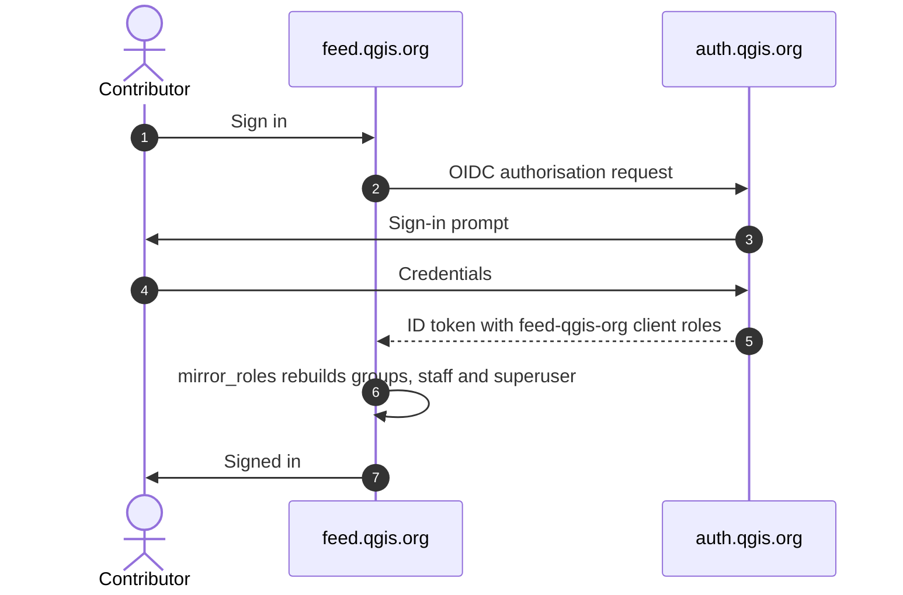
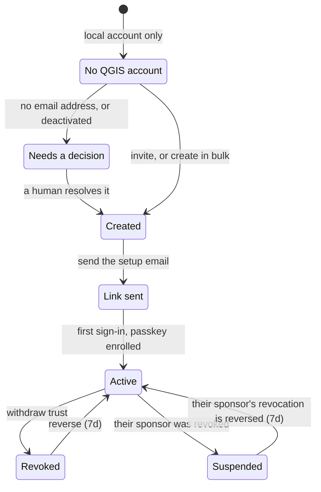
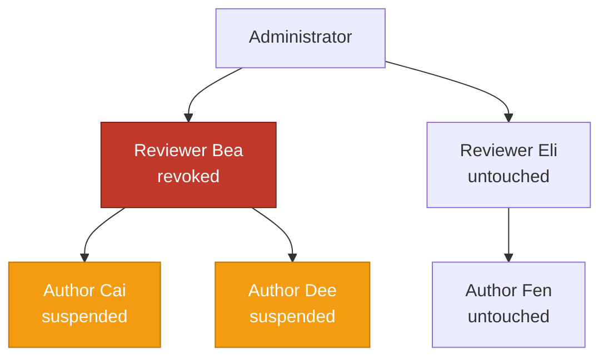

# Single sign-on with auth.qgis.org

This page is for the people who run the feed site. It explains how people sign
in through the QGIS account service, who may invite whom, how to withdraw
trust, and which settings control it.

Contributors have their own guide at `/sso/help/`. It explains how to get an
account, set up a passkey, invite somebody, what each role allows, and what to
do when you cannot sign in. Anybody can read it while signed out. It lives in
`qgisfeedproject/templates/qgis_sso/help.html`, so update it with the code.

The [design notes](sso-design.md) explain why the rules below exist.

## How a sign-in works

Keycloak owns the account and the credential. This site keeps a link to the
Keycloak subject and a copy of what the roles mean here.

We rebuild the Django groups and the staff and superuser flags from the
Keycloak client roles at every sign-in. When you add or remove a role in
Keycloak, the change applies here at the person's next sign-in.

> **Edit roles in Keycloak, on the `feed-qgis-org` client.** If you change the
> checkboxes in `/admin/` on a linked account, the next sign-in undoes it.

## What each role grants

`SSO_ROLE_MAP` in `settings.py` holds the mapping. Mirroring only touches the
groups in `SSO_MANAGED_GROUPS`, so any other group survives a sign-in.

| Keycloak client role | Django groups | staff | superuser |
|---|---|---|---|
| `admin` | authors, approver | ✅ | ✅ |
| `web-maintainer` | authors, approver | ✅ | ✅ |
| `reviewer` | authors, approver | ✅ | |
| `usergroup-author` | authors | ✅ | |
| `author` | authors | ✅ | |

## The people page

Anybody with a realm account can open `/sso/manage/`, and each person sees only
what they are entitled to see. A superuser sees every account that has a
Keycloak identity. Everybody else sees the accounts they vouched for. The page
shows ten rows at a time, and you can filter by state or search by name.

The newest invitation is at the top. Click **Account**, **State**, **Date of
invitation** or **Invited by** to sort by that column, and click it again to
turn the order around. **State** sorts in the order people move through it,
from created to revoked, rather than by the alphabet. Sorting covers the whole
list, not just the page you are looking at, and it keeps whatever you searched
for or filtered by. **Invited by** only appears for a superuser, because
everybody else sees their own invitations and would read their own name on
every row.

The filtering, the search, the sorting and the paging all happen in the
database, so the page costs the same whether the site has a hundred accounts or
a hundred thousand.

Every button on a row acts on that row alone. If the account sits outside your
own branch of the tree, the action is refused, whether or not the listing
happened to show it.

An action that asks before it acts opens a page at its own address. You can read
it, reload it, and leave again without anything having happened.

| Action | What it does |
|---|---|
| Send email | Opens `/sso/manage/send-email/<id>/`, which asks first. The email reaches a real contributor and you cannot unsend it. |
| Get the setup link | Shows the setup link on a page of its own. See [Handing over a link](#handing-over-a-link). |
| Cancel invitation | Opens `/sso/manage/cancel-invitation/<id>/`, which asks first. See [Cancelling an invitation](#cancelling-an-invitation). |
| Withdraw trust | Opens `/sso/manage/revoke/<id>/`. See [Withdrawing trust](#withdrawing-trust). |

Some accounts cannot be invited at all, because they have no email address or
somebody deactivated them. The invite page leaves those out and counts them in
a line under its table. Deal with them in the admin user list, using its **SSO
account** filter. Dormant accounts and accounts that have never been used do
appear there, with the warning shown beside them. Those warnings belong to the
invite page, where the question is whether to create an account. The people
page is about accounts that already exist, so it does not repeat them.

## Invitations

Somebody with quota brings in somebody they know, and the new account records
for good who vouched for it. The people page offers two routes:

- **Invite a new user.** Anyone whose roles carry quota can use this. You fill in a
  short form, and we create the account straight away both here and in the
  realm. Nothing reaches the person until you send it. The role starts empty, so
  you always choose it yourself.
- **Invite existing users.** Superusers only, because it reaches the whole user list.
  It takes an account that already exists here and gives it a place in the
  realm. You pick the people, and the next page names each one and what will
  happen to them before anything is created.

Who may offer what is the ladder in `SSO_ROLE_TIERS`, with quotas in
`SSO_TIER_QUOTAS`.

| Tier | Role | May offer | Open places |
|---|---|---|---|
| 0 | `admin` | anything | unlimited |
| 1 | `web-maintainer` | tier 1 and below | 25 |
| 2 | `reviewer` | tier 2 and below | 10 |
| 3 | `usergroup-author` | tier 3 and below | 10 |
| 4 | `author` | `author` only | 3 |

Somebody who holds two roles gets the more privileged tier and the *larger* of
the two allowances, never the sum of them. Every account you invited that has
not signed in yet holds one of your places, and that place comes back to you
when they do sign in. The username and the address must both be free here and
in the realm.

### What a username may contain

The form applies the rules the realm applies, so a name it would refuse is
refused here, with a message that says which rule it broke.

| Rule | Why |
|---|---|
| Three characters or more | Keycloak's own floor. |
| 255 characters or fewer | Keycloak's ceiling, and the same for the address and the two names. |
| No spaces | Keycloak refuses whitespace in a username. A dot or an underscore reads as well. |
| None of `< > & " '` | Keycloak refuses these in a username, a first name and a last name alike. |

We save the username in lower case, so `NewBie` becomes `newbie`. Keycloak
treats usernames case insensitively and stores them that way, and matching it
means the account here and the QGIS account carry one name rather than two that
differ by case.

One Keycloak rule we do not repeat is the one about names that mix scripts so
they read as somebody else's name. It depends on tables that change with each
Unicode version, so the realm stays the only place it lives. A name it catches
fails when we create the account, and the page says the account could not be
created.

### Cancelling an invitation

Before the person signs in, the whole invitation can be undone. The row offers
it, and `/sso/manage/cancel-invitation/<id>/` asks first, because it removes the
account here and in the realm and cannot be undone. Nothing is kept, so the
place comes back to you and the same person can be invited again with the same
name and address. Once they have signed in there is nothing to cancel, and
[withdrawing trust](#withdrawing-trust) is what is meant instead.

### Linking to an account that already exists in the realm

The realm is shared with hub and plugins, so a long-standing contributor here
very likely has a QGIS account already. For those accounts *Invite existing
users* shows a third outcome, **will be linked**, and names the QGIS account it
matched. We create nothing in the realm, and linking grants no privilege the
account did not already hold here.

We match on one thing only: an exact address that Keycloak reports as verified.
Three cases are refused, and the page names which one it hit. The address
differs, the realm has not verified it, or the realm account already belongs to
somebody here. One run links up to `SSO_ADMIN_ACTION_MAX_USERS` accounts (25).

## Withdrawing trust

One action has two outcomes. The person you act on is **revoked**. Everybody
they vouched for is **suspended**, which is deliberately lighter, because those
people have done nothing wrong.

| | Revoked | Suspended |
|---|---|---|
| Client roles | removed, recorded first | none here, now and at every sign-in |
| Realm account | disabled at `auth.qgis.org` | untouched |
| Local account | deactivated | active, with a banner explaining why |
| Can sign in | no | yes, with no permissions |

Who may act:

- You can act anywhere in your own part of the tree and nowhere else. Never on
  somebody above you, never across into another branch. This holds for
  administrators as well.
- No administrator can revoke another administrator. Take the `admin` role off
  them in Keycloak first, then revoke.
- Standing down voluntarily is not built yet. It would move the people below
  somebody to a new sponsor rather than suspend them, so it is not this button.

Opening `/sso/manage/revoke/<id>/` changes nothing, so you can read the page
and leave it. It asks you for a reason, which goes into the audit trail, and it
names every person the revocation would reach.

You can reverse a revocation for `SSO_REVOCATION_GRACE_DAYS` (7). One action
puts the recorded roles back, re-enables the realm account, and clears the
suspension for everybody below them. After that the record stays but the button
goes. Anybody suspended by a *different* revocation is left alone.

We keep the person's content. `SSO_ON_REVOKE` points at
`qgisfeed.trust.on_revoke`, which sends entries in *pending review* or
*approved* back to *draft*. Published entries stay published, and we delete
nothing and re-attribute nothing.

## Handing over a link

Sometimes you have somebody on a call and their email is not arriving. *Get
the setup link* on their row takes you to `/sso/manage/link/`, a page that shows
that one link and nothing else. Inviting a new user brings you to the same page.
We never store the link and never log it, and the page takes it out of the
session as it renders, so a reload asks you to issue a fresh one.

Under the link is a QR code of the same thing. The person can scan it straight
onto the device their passkey will live on, instead of reading a long token out
to you. It is the same credential in another shape, so hand it over with the
same care.

This works only for accounts that have not signed in yet. The button disappears
after the first sign-in, and the view refuses the request in any case, because
by then the link would sign the person in without asking for a passkey. If
somebody who has signed in loses every device, use *Send the account-setup
email* in the admin instead. It reaches their own address, not yours.

The button needs an extension in Keycloak. It depends on PhaseTwo's
[magic-link extension](https://github.com/p2-inc/keycloak-magic-link) deployed
into `/opt/keycloak/providers/`. Without it the button reports a 404, and the
identity's detail page links to the Keycloak admin console instead. There you
can see the state of the person's credentials and retry the send, which uses
Keycloak's own SMTP settings rather than Django's.

> ⚠ **Verify a link end to end on a throwaway realm before relying on this.**
> A magic link signs the person in, so if the required actions do not fire they
> land signed in with no passkey, which is worse than the email path.

## Passkeys and the profile page

Your own page is at `/sso/profile/`, reached from the username in the header.
It shows your username and address, what your Keycloak roles let you do here,
and your passkeys with the date each one was enrolled.

The passkey list arrives a moment after the rest of the page, because reading
it means asking auth.qgis.org. A slow account service never holds up the rest
of the page. The list comes from `/sso/profile/passkeys/`, which answers only
about whoever is signed in and reads nothing from the URL.

Adding or removing a passkey happens at `auth.qgis.org`, and it has to.
*Add a passkey* starts an ordinary sign-in that asks Keycloak to run the
enrolment, then brings you back to the profile page. This site never changes a
credential itself. It also refuses to remove your last passkey, because that
would lock you out. Enrol the replacement first.

*Edit profile* opens your account at auth.qgis.org in a new tab. An account
with no realm identity still gets the page, and we tell it there are no
passkeys to manage.

## Migrating a wave in the admin

The people page works one row at a time. To move a whole wave of people, use
the Django admin: filter the changelist, select the accounts, then run an
action. Both routes call the same code, so the rules and the wording match
wherever you start. All four actions are superuser only and audited, and each
one does a single thing, so no step happens as a side effect of another.

| Where | Action | What it does |
|---|---|---|
| Users | Export the migration report | Downloads a CSV and changes nothing. |
| Users | Create the Keycloak account | Creates realm accounts and sends no email. |
| Keycloak identities | Send the account-setup email | Invites them, and you can run it again. |
| Keycloak identities | Disable the local Django password | Retires the password fallback, near the end of a migration. |

**1. Read the report first.** The CSV tells you the Keycloak username and the
client roles each account would get. It also flags the accounts that need a
person to decide: a missing email address, a deactivated account, and accounts
that are dormant or have never been used. Keep the file as your record of the
migration.

**2. Create the accounts.** A confirmation page lists the outcome for each
person before we write anything, and that page is the only preview you get. We
hold the flagged accounts back unless you tick the box. One run creates up to
`SSO_ADMIN_ACTION_MAX_USERS` accounts (25), so migrate in waves.

**3. Send the setup email.** A link lasts 14 days, and these accounts have no
password to fall back on, so send it again whenever somebody misses the window
or loses every device. We count each send on the identity record.

> ⚠ **Staging can email real contributors.** The staging database is restored
> from production and holds every contributor's real address, and the staging
> realm uses the real Resend credential and can send from `noreply@qgis.org`.
> Check who you have selected. A setup link cannot be unsent.

Announce the migration on the mailing list before the first email goes out, and
name the exact address it will come from. An account-setup email nobody expects
reads as phishing.

**4. Disable local passwords.** This is mostly automatic, because we retire a
password the moment that account first signs in through Keycloak. The action
only touches accounts with a recorded successful SSO login, and it reports the
rest and leaves them alone. Use it to catch up accounts that signed in before
this became automatic, and to check where a batch stands.

## What a wave costs, and why it still takes a moment

Every person in a wave costs at least one read against auth.qgis.org before we
create anything, and one or two writes after you confirm. That is why the limit
of 25 exists, and why the page asks you to wait.

The reads for a wave run together, eight at a time, so the lookups are a handful
of rounds rather than a queue. The writes stay one after another, in the order
you picked people, so the report you get back can name exactly who was created
and who was held back.

Two things are cached in each worker process for ten minutes: the feed client's
internal id, and the list of roles it has. They only change when we deploy a
role. If you add a role in Keycloak and this site still says it has no role by
that name, wait ten minutes or restart the workers. Nothing about a person is
ever cached.

> **The cache lives in the worker, not in a shared store.** Each gunicorn worker
> keeps its own copy, and a restart empties it. Read `CACHES` in `settings.py`
> before you make anything else depend on it.

If a wave is slow enough to worry you, the realm is usually the reason. A read
gives up after ten seconds and the page tells you it could not reach the account
service, rather than holding the request until gunicorn kills it.

## Retiring local login

The user list in the admin has an **SSO account** filter. Combine it with the
*last login* filter to find active accounts that are not linked yet. Every
sign-in with a local password is recorded, so you can count them under **SSO
audit events**, filtered by action.

> ⚠ **Keep `LOCAL_LOGIN_ENABLED` on until break-glass access exists and has
> been tested.** Without it, a Keycloak outage locks out every administrator.

## Settings reference

| Setting | Meaning |
|---|---|
| `LOCAL_LOGIN_ENABLED` | Turns on the password backend, the password form, and password sign-in at `/admin/login/`. |
| `SSO_MIGRATION_LINKING` | Links a token to an existing local account when the username and a verified email both match. Turn it on only during the cutover. |
| `OIDC_CREATE_USER` | Must stay `False`. The realm federates the OSGeo LDAP directory. |
| `OIDC_RP_CLIENT_SECRET` | The client secret. Set it in `settings_local`, never in the process environment. |
| `SSO_PROVISIONER_CLIENT_SECRET` | The provisioning service account's secret. The same rule applies. |
| `SSO_REQUIRED_ACTIONS` | What a new account must complete in Keycloak. The default asks for a verified email and a passkey, and never sets a password. |
| `SSO_RETIRE_PASSWORD_ON_LOGIN` | Retires the local password at the first SSO sign-in. `False` keeps both ways in open. |
| `SSO_ADMIN_ACTION_MAX_USERS` | How many accounts one run creates or links (25). |
| `SSO_LOOKUP_CONCURRENCY` | How many realm lookups run at once while we decide about a wave (8). Writes stay one at a time. |
| `SSO_SETUP_REDIRECT_URI` | Where Keycloak sends somebody who has finished setting up. Register it as a redirect URI on the `feed-qgis-org` client. |
| `SSO_REVOCATION_GRACE_DAYS` | How many days you can undo a revocation in one action (7). |
| `QGIS_AUTH_URL` | The public address of the account service. The OIDC endpoints and the expected token issuer come from it. |
| `SSO_KEYCLOAK_SERVER_URL` | The admin API address, when it differs from the public one. It defaults to `QGIS_AUTH_URL`. |
| `SSO_KEYCLOAK_REALM` | The realm name, `qgis` by default. |
| `SSO_MAGIC_LINK_URL` | The PhaseTwo magic-link endpoint that issues setup links. It is built from `SSO_KEYCLOAK_SERVER_URL`, because this site calls it. |

### Two addresses for one Keycloak

Browsers and tokens use the public address. The admin API is sometimes only
reachable on an internal address, for example through a VPN.

Set `QGIS_AUTH_URL` to the public address and `SSO_KEYCLOAK_SERVER_URL` to the
internal one. Never point `QGIS_AUTH_URL` at the internal address. Every token
is checked against it, so an account created that way is refused at its first
sign-in. The log then says `Subject is linked to a different issuer`.

Keycloak builds the setup link from the realm's frontend URL, so the link
always uses the public address.

Correcting the settings later does not help an account created against the
wrong address. Its identity keeps that issuer, so create the account again.
